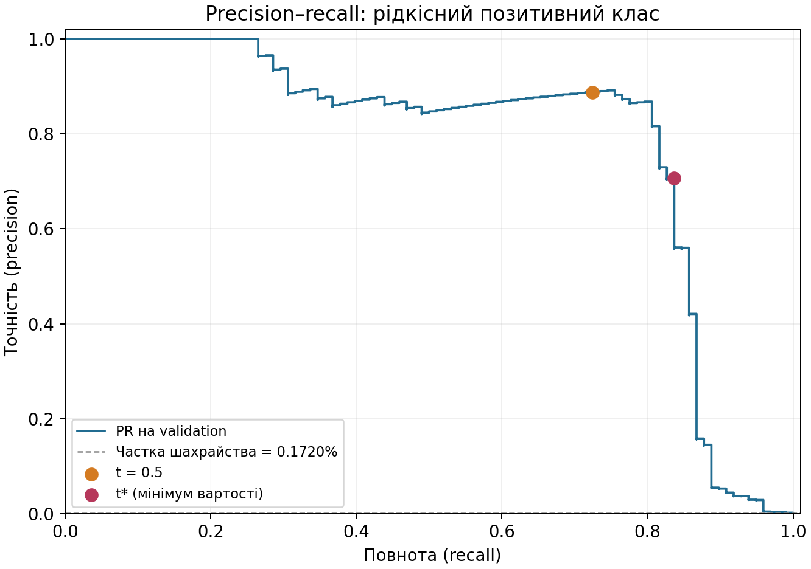
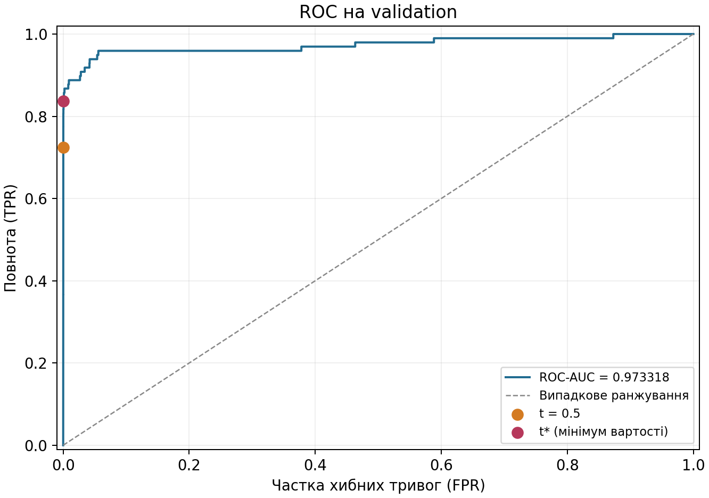

# ЛР2. Поріг рішення під асиметричну ціну помилок

## Мета роботи

Дослідити, як поріг рішення змінює вартість помилок незмінної
нейронної мережі для виявлення шахрайських транзакцій:

1. знайти на validation поріг, що мінімізує вартість $`C=10FN+FP`$;
2. незалежно перевірити алгоритм пошуку на трьох малих наборах;
3. застосувати зафіксований поріг до test та проаналізувати FP і FN.

## Відтворення

Потрібні Python 3.12 та uv.

Із теки `lab2/`:

```bash
uv sync --frozen
uv run --frozen python analysis.py --saved results
```

Команда читає збережені прогнози з `results/` і записує таблиці,
метрики та графіки в `reproduced/`, без CSV і повторного навчання.
Перед тестовою оцінкою автоматично виконуються перевірки A/B/C;
незбіг порога або лічильників завершує аналіз із помилкою.

Завантаження даних і відтворення навчання:

```bash
mkdir -p data
curl --fail --location \
  --output data/creditcard.csv \
  https://storage.googleapis.com/download.tensorflow.org/data/creditcard.csv
uv run --frozen python lab2_starter.py \
  --data data/creditcard.csv --out results_retrained
```

Навчання зберігає новий експеримент у `results_retrained/`; ця тека
під час запуску має бути новою або порожньою. Залежності мають точні
версії в `pyproject.toml`, а повне транзитивне оточення зафіксоване
у `uv.lock`.

## Структура файлів

| Файл | Призначення |
|---|---|
| `lab2_starter.py` | Поділ даних, стандартизація, навчання та збереження прогнозів |
| `thresholds.py` | Ручні лічильники, вартість та пошук порога через кумулятивні суми |
| `checks.py` | Незалежна перевірка пошуку на наборах A/B/C |
| `analysis.py` | Криві, вибір порога, тестова оцінка й аналіз помилок |

## 1. Дані та підготовка

Використано [Credit Card Fraud Detection, MLG–ULB](https://www.kaggle.com/datasets/mlg-ulb/creditcardfraud):
284807 транзакцій, із них 492 шахрайські. Мітка `Class=1` означає
шахрайство, `Class=0` — легітимну транзакцію.

Для поділу створено індекси `np.arange(len(y))`. Спочатку
`train_test_split` відокремив 40% з `stratify=y` та `random_state=0`.
Відкладені індекси поділено навпіл із `test_size=0.5`, стратифікацією
за їхніми мітками та `random_state=0`: перша частина — validation,
друга — test. Отримано поділ 60/20/20 з округленням розмірів.

| Вибірка | Об'єктів | Шахрайських | Легітимних | Частка шахрайських |
|---|---:|---:|---:|---:|
| Train | 170884 | 295 | 170589 | `0.172632%` |
| Validation | 56961 | 98 | 56863 | `0.172048%` |
| Test | 56962 | 99 | 56863 | `0.173800%` |

Початковий порядок рядків CSV перед поділом збережено. Вихідний
індекс від 0 без заголовка використано як `row_id`. Усі транзакції
залишилися в поділі по одному разу.

Вхід містить 29 ознак: `V1`–`V28` та `Amount`. `Class` і `Time`
до входу моделі не включені. Сирий `Amount` збережено окремо.

Для ознаки $`j`$ статистики обчислено лише на train:

```math
\mu_j=\frac{1}{N_{\mathrm{tr}}}\sum_{i\in\mathrm{tr}}X_{ij},
\qquad
\sigma_j=\sqrt{\frac{1}{N_{\mathrm{tr}}}\sum_{i\in\mathrm{tr}}(X_{ij}-\mu_j)^2}.
```

`StandardScaler` використовує `ddof=0`. До всіх трьох вибірок
застосовано ті самі train-статистики:

```math
X'_{ij}=\frac{X_{ij}-\mu_j}{\sigma_j}.
```

Після стандартизації входи перетворено на `float32`. Обчислення
статистик на всьому наборі передало б інформацію про validation/test
у підготовку моделі та створило б витік даних.

## 2. Мережа та навчання

Архітектура:

```math
X\rightarrow\mathrm{Linear}(29,32)
\rightarrow\mathrm{ReLU}
\rightarrow\mathrm{Linear}(32,1).
```

Обчислення виконано на CPU у `float32`. Перед створенням моделі
викликано `torch.manual_seed(0)`; параметри отримано стандартною
ініціалізацією `nn.Linear`. Використано Adam зі швидкістю навчання
$`\eta=10^{-3}`$ та рештою параметрів за замовчуванням.

Мережу навчено 12 епох пакетами по 1024 об'єкти, включно з останнім
неповним пакетом. Окремий `np.random.default_rng(0)` створював нову
перестановку train на кожній епосі. Використано стартовий
`lab2_starter.py` викладача без змін.

`BCEWithLogitsLoss` усереднює втрату за пакетом без ваг класів.
Для $`B`$ об'єктів і логітів $`z_i`$ обчислюється стабільний вираз:

```math
L=\frac{1}{B}\sum_{i=1}^{B}
\left[\max(z_i,0)-y_i z_i+\log\left(1+e^{-|z_i|}\right)\right].
```

Середня BCE, накопичена за пакетами епохи, зменшилася з `0.365299`
на першій епосі до `0.003383` на дванадцятій. Для подальшого аналізу
взято ваги після 12-ї епохи; модель навчено один раз.

## 3. Оцінки, метрики та вартість

Після `model.eval()` та без обчислення градієнтів отримано оцінки
для validation і test:

```math
s_i=\sigma(z_i)=\frac{1}{1+e^{-z_i}}.
```

Ваги збережено в `results/model.pt`, а індекси поділу, мітки, сирі
Amount і оцінки — у `results/predictions.npz`. Оцінки не округлювалися;
пошук порога виконується за цими зафіксованими масивами.

Для порога $`t`$ прогноз визначається правилом:

```math
\widehat y_i=\mathbf{1}[s_i\geq t].
```

Ручні лічильники:

```math
TP=\sum_i\mathbf{1}[y_i=1,s_i\geq t],
\qquad
FP=\sum_i\mathbf{1}[y_i=0,s_i\geq t],
```

```math
FN=\sum_i\mathbf{1}[y_i=1,s_i\lt t],
\qquad
TN=\sum_i\mathbf{1}[y_i=0,s_i\lt t].
```

Вартість помилок:

```math
C(t)=10FN(t)+FP(t).
```

$`FN`$ — пропущене шахрайство, $`FP`$ — хибна тривога.
Вартість вимірюється в умовних одиницях; `Amount` у формулу не входить.

Точність і повнота:

```math
\mathrm{precision}=\frac{TP}{TP+FP},
\qquad
\mathrm{recall}=\frac{TP}{TP+FN}.
```

Precision — частка справжнього шахрайства серед спрацювань;
recall — частка знайденого шахрайства серед усіх шахрайств.
При $`TP+FP=0`$ precision не визначена, бо немає позитивних прогнозів.
При $`TP+FN=0`$ recall не визначена, бо немає позитивних міток.

## 4. Пошук порога на validation

Кандидати — усі унікальні оцінки validation та $`+\infty`$.
Нескінченний поріг дає «усі негативні», а найменша оцінка —
«усі позитивні». Між сусідніми оцінками прогнози не змінюються.

Оцінки сортуються за спаданням разом із мітками. Для останньої
позиції $`k`$ кожної групи рівних оцінок використовуються префіксні суми:

```math
TP_k=\sum_{i=0}^{k}y_{(i)},
\qquad
FP_k=k+1-TP_k.
```

Якщо $`P`$ і $`N`$ — кількості позитивних і негативних міток:

```math
FN_k=P-TP_k,
\qquad
TN_k=N-FP_k,
\qquad
C_k=10FN_k+FP_k.
```

Рівні оцінки включаються всі разом: зупинка всередині групи не
відповідала б правилу $`s_i\geq t`$. Після сортування всі лічильники
отримуються за лінійний прохід. Для $`n=56961`$ оцінок validation
загальна складність — $`O(n\log n)`$, додаткова пам'ять — $`O(n)`$.
Повторного проходу по validation для кожного кандидата немає.

Серед порогів із мінімальною вартістю обирається найбільший.
Перевірено 55989 кандидатів. Повна таблиця порогів, лічильників
і вартостей збережена в `results/validation_candidates.csv`.

| Правило | Поріг | $`TP`$ | $`FP`$ | $`FN`$ | $`TN`$ | $`C`$ |
|---|---:|---:|---:|---:|---:|---:|
| Стандартний поріг | `0.5` | 71 | 9 | 27 | 56854 | 279 |
| Мінімум вартості | `0.031193915755` | 82 | 34 | 16 | 56829 | 194 |
| Усі негативні | $`+\infty`$ | 0 | 0 | 98 | 56863 | 980 |

Отриманий поріг:

```math
t^*=0.031193915754556656.
```

Поріг зафіксовано в `results/threshold.json` до тестової оцінки.
Округлення використано лише для відображення. Наприклад, транзакція
з validation у рядку 149577 має мітку 1 й оцінку, що точно дорівнює
$`t^*`$: правило $`s\geq t^*`$ зараховує її до TP. Округлення порога
до `0.031194` виключило б цю транзакцію та перетворило TP на FN.

## 5. PR- і ROC-криві на validation

PR- і ROC-криві побудовано функціями scikit-learn за тими самими
збереженими оцінками validation. На графіках позначено робочі точки
для порогів `0.5` і $`t^*`$.





Отримана ROC-AUC:

```math
\mathrm{ROC\!-\!AUC}=0.9733177163730801.
```

ROC порівнює recall із часткою хибних тривог:

```math
\mathrm{FPR}=\frac{FP}{FP+TN}.
```

ROC-AUC характеризує ранжування оцінок. Для порогів `0.5` і $`t^*`$
вона однакова, хоча вартість на validation становить 279 і 194
відповідно. Отже, висока ROC-AUC сама по собі не визначає вартості
конкретного рішення та не враховує співвідношення штрафів $`10:1`$.

За $`t^*`$ хибних тривог лише 34 серед 56863 легітимних транзакцій,
тому FPR мала. Проте серед 116 спрацювань справжніх шахрайств 82:
precision дорівнює `0.706896552`. Велика кількість легітимних
транзакцій дозволяє мати малу FPR одночасно з помітною часткою FP
серед спрацювань. PR-крива безпосередньо показує цей компроміс
між precision і recall; пунктир відповідає частці шахрайства.

## 6. Незалежна перевірка пошуку

На наборах A/B/C еталон окремо формує кандидатів із вихідних оцінок
через `set` та `sorted`. Для кожного порога прямий цикл застосовує
$`s_i\geq t`$ і рахує TP, FP, FN, TN та C. Він не використовує таблицю,
кумулятивні суми чи лічильники швидкого алгоритму.

Усі пороги й цілі лічильники порівнюються точно, без допусків.
Поріг еталона мінімізує пару $`(C,-t)`$, тобто дотримується того самого
правила нічиєї. Додатково перевірено незалежність від порядку прикладів.

### Набір A

Дві оцінки `0.7` з різними мітками переходять у позитивний клас
одночасно. При цьому порозі отримано $`TP=1`$, $`FP=2`$, $`FN=1`$;
варіант із включенням лише одного з двох об'єктів не виникає.

| Поріг | $`TP`$ | $`FP`$ | $`FN`$ | $`TN`$ | $`C`$ (швидкий) | $`C`$ (прямий) | Збіг |
|---:|---:|---:|---:|---:|---:|---:|:---:|
| $`+\infty`$ | 0 | 0 | 2 | 4 | 20 | 20 | так |
| `0.9` | 0 | 1 | 2 | 3 | 21 | 21 | так |
| `0.7` | 1 | 2 | 1 | 2 | 12 | 12 | так |
| `0.4` | 2 | 2 | 0 | 2 | 2 | 2 | так |
| `0.2` | 2 | 3 | 0 | 1 | 3 | 3 | так |
| `0.1` | 2 | 4 | 0 | 0 | 4 | 4 | так |

Обраний поріг: `0.4`.

### Набір B

Усі три мітки нульові. Кожне спрацювання додає FP, тому серед
кандидатів нульову вартість дає лише $`+\infty`$. Recall не визначена:
$`TP+FN=0`$, бо в наборі немає позитивного класу.

| Поріг | $`TP`$ | $`FP`$ | $`FN`$ | $`TN`$ | $`C`$ (швидкий) | $`C`$ (прямий) | Збіг |
|---:|---:|---:|---:|---:|---:|---:|:---:|
| $`+\infty`$ | 0 | 0 | 0 | 3 | 0 | 0 | так |
| `0.9` | 0 | 1 | 0 | 2 | 1 | 1 | так |
| `0.6` | 0 | 2 | 0 | 1 | 2 | 2 | так |
| `0.3` | 0 | 3 | 0 | 0 | 3 | 3 | так |

Обраний поріг: $`+\infty`$.

### Набір C

При порозі `0.8` отримано $`FN=1`$, $`FP=0`$, а при `0.5` —
$`FN=0`$, $`FP=10`$. Включення всієї групи `0.5` усуває один FN
і додає десять FP, тому обидва рішення мають однакову вартість 10.

| Поріг | $`TP`$ | $`FP`$ | $`FN`$ | $`TN`$ | $`C`$ (швидкий) | $`C`$ (прямий) | Збіг |
|---:|---:|---:|---:|---:|---:|---:|:---:|
| $`+\infty`$ | 0 | 0 | 2 | 11 | 20 | 20 | так |
| `0.8` | 1 | 0 | 1 | 11 | 10 | 10 | так |
| `0.5` | 2 | 10 | 0 | 1 | 10 | 10 | так |
| `0.2` | 2 | 11 | 0 | 0 | 11 | 11 | так |

Обрано більший із двох порогів мінімальної вартості: `0.8`.

Усі пороги, лічильники й вартості швидкого алгоритму точно збіглися
з прямим перебором. Усі три перевірки пройдено до тестової оцінки.

## 7. Тестова оцінка

До test застосовано зафіксований validation-поріг $`t^*`$.
Для порівняння обчислено результати стандартного порога `0.5`.

| Правило | Поріг | $`TP`$ | $`FP`$ | $`FN`$ | $`TN`$ | $`C`$ | Precision | Recall |
|---|---:|---:|---:|---:|---:|---:|---:|---:|
| Стандартний поріг | `0.5` | 71 | 8 | 28 | 56855 | 288 | `0.898734177` | `0.717171717` |
| Поріг із validation | `0.031193915755` | 80 | 43 | 19 | 56820 | 233 | `0.650406504` | `0.808080808` |

Матриця плутанини при $`t^*`$; рядки — фактичний клас, стовпці — прогноз:

| Фактичний клас | Прогноз 0 | Прогноз 1 |
|---|---:|---:|
| 0, легітимна | 56820 | 43 |
| 1, шахрайство | 19 | 80 |

```math
\mathrm{precision}=\frac{80}{80+43}\approx0.650406504.
```

```math
\mathrm{recall}=\frac{80}{80+19}\approx0.808080808.
```

```math
C=10\cdot19+43=233.
```

## 8. Аналіз FP і FN

Із 43 FP і 19 FN відібрано перші п'ять кожного типу за початковим
номером рядка CSV, від 0 без заголовка.

| Рядок CSV | Тип | Мітка | Оцінка $`s`$ | Amount | $`\lvert s-t^*\rvert`$ |
|---:|:---:|---:|---:|---:|---:|
| 460 | FP | 0 | `0.196158603` | `2.00` | `0.164964687` |
| 2961 | FP | 0 | `0.080960780` | `2.49` | `0.049766865` |
| 10783 | FP | 0 | `0.966327071` | `89.99` | `0.935133155` |
| 13405 | FP | 0 | `0.932031631` | `89.99` | `0.900837716` |
| 13617 | FP | 0 | `0.922762215` | `89.99` | `0.891568299` |
| 10497 | FN | 1 | `0.011464343` | `3.79` | `0.019729572` |
| 52521 | FN | 1 | `0.006373129` | `105.99` | `0.024820786` |
| 55401 | FN | 1 | `0.005641569` | `1.00` | `0.025552347` |
| 91671 | FN | 1 | `0.000500424` | `290.18` | `0.030693492` |
| 93486 | FN | 1 | `0.018351529` | `0.00` | `0.012842387` |

`Amount` містить сирі суми, а не стандартизовану ознаку.
Для FP $`s-t^*\geq0`$, для FN $`s-t^*\lt0`$.
Порівняння відібраних прикладів з усіма помилками на test:

| Приклади | Кількість | Медіана Amount | Медіана $`\lvert s-t^*\rvert`$ |
|---|---:|---:|---:|
| Перші п'ять FP | 5 | `89.99` | `0.891568299` |
| Усі FP | 43 | `2.49` | `0.024990063` |
| Перші п'ять FN | 5 | `3.79` | `0.024820786` |
| Усі FN | 19 | `33.76` | `0.029118338` |

У наведених FP сирі Amount лежать у межах `2.00`–`89.99`,
у FN — `0.00`–`290.18`. Серед перших п'яти FP медіана суми
вища, ніж серед FN, а в повній сукупності помилок співвідношення
протилежне. Три з п'яти FP мають оцінку понад `0.92` і однаковий
Amount `89.99`; повторення цієї суми не встановлює причини помилки.

Відстані наведених FP до порога становлять
`0.049766865`–`0.935133155`, для FN —
`0.012842387`–`0.030693492`. Медіана відстані перших п'яти FP
у `35.7` раза більша за медіану всіх FP: ці приклади не відображають
типового відступу хибних тривог від порога. Для FN медіани відстаней
близькі, проте за сумами перші п'ять також відрізняються від усіх FN.

За десятьма прикладами не можна встановити причини помилок моделі.
Відбір за номером рядка не є випадковим, а наведені медіани показують
його нерепрезентативність. Amount — лише одна з 29 вхідних ознак,
тому відмінність сум не доводить, що саме вона спричинила помилку.

## Висновки

Вибір порога змінив рішення незмінної моделі: ваги, логіти та
ранжування залишилися тими самими. На validation вартість зменшилася
з 279 до 194, на 85 (`30.47%`), ціною 25 додаткових FP
за 11 усунутих FN.

На test вартість зменшилася з 288 до 233, на 55 (`19.10%`).
Дев'ять додатково виявлених шахрайств скоротили штраф на 90 одиниць,
а 35 додаткових хибних тривог додали 35:

```math
\Delta C=10\cdot(-9)+35=-55.
```

Precision знизилася з `0.898734177` до `0.650406504`,
recall зросла з `0.717171717` до `0.808080808`.

Мінімум на validation не гарантує такого самого виграшу на test:
поріг обрано за помилками скінченної вибірки, у якій мало шахрайств.
Розташування оцінок біля межі на нових даних може відрізнятися.
Зміна порога за результатами test перетворила б його на ще одну
validation-вибірку та порушила б незалежність підсумкової оцінки.

## Використані джерела та інструменти

- Умова «ЛР2. Поріг рішення під асиметричну ціну помилок» та стартовий код викладача.
- Конспекти лекцій 3–5: зворотне поширення, оптимізація та узагальнення.
- [Credit Card Fraud Detection, MLG–ULB](https://www.kaggle.com/datasets/mlg-ulb/creditcardfraud).
- [Копія набору в прикладі TensorFlow](https://www.tensorflow.org/tutorials/structured_data/imbalanced_data): використано лише джерело CSV.
- Документація [PyTorch](https://docs.pytorch.org/docs/stable/generated/torch.nn.BCEWithLogitsLoss.html) та [scikit-learn](https://scikit-learn.org/stable/modules/generated/sklearn.metrics.precision_recall_curve.html).
- OpenAI Codex.
