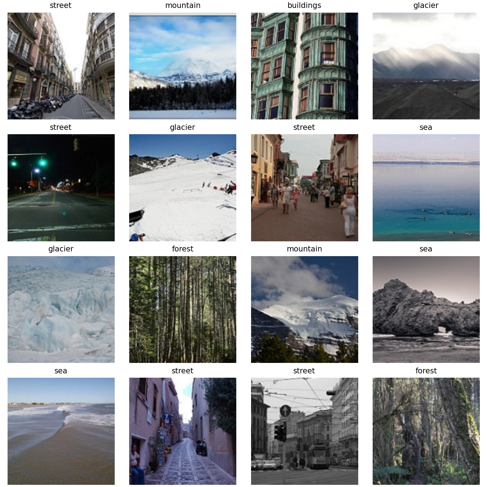
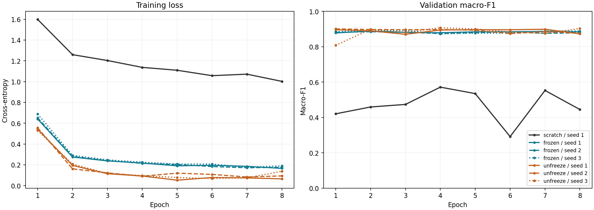
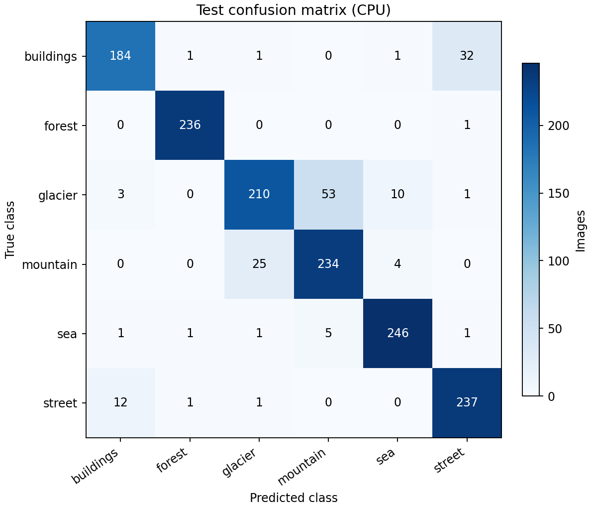
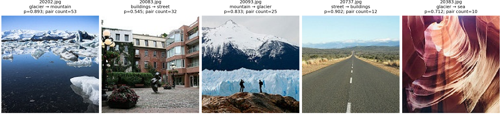

# ЛР3. Обчислювальний експеримент і трансферне навчання

## Мета роботи

Порівняти три режими навчання ResNet-18 на малій вибірці за однакового
обчислювального бюджету:

1. навчання всієї мережі з випадкових ваг — `scratch`;
2. навчання нової голови з незмінним кістяком ImageNet — `frozen`;
3. донавчання останнього блоку кістяка та нової голови — `unfreeze`.

Окремо виміряти ефект попередньо навчених ознак і ефект розморожування,
порівняти їх із розкидом між зернами та оцінити вибрану конфігурацію
на test. Кожен запуск має однакові 8 епох по 38 кроків, разом
304 кроки оптимізатора. Мінімальна якість класифікації не встановлена.

## Відтворення

Потрібні Python 3.12 та uv. Із теки `lab3/`:

```bash
uv sync --frozen
uv run --frozen python download_data.py --out data
uv run --frozen python analysis.py --data data --out reproduced_run2
```

Аналіз відтворює числа звіту без повторного навчання й записує
таблиці та рисунки в `reproduced_run2/`.

Повторне навчання та аналіз нового експерименту:

```bash
uv run --frozen python train.py --data data --out experiment_run2
uv run --frozen python analysis.py --data data \
  --experiment experiment_run2 --out analysis_run2
```

## Структура файлів

| Файл | Призначення |
|---|---|
| `download_data.py` | Завантаження Intel Image Classification без seg_pred |
| `common.py` | Константи, хеші, метадані коду й середовища |
| `data.py` | Точний поділ, контрольна таблиця, RGB і перетворення |
| `models.py` | Побудова ResNet-18, режими, AdamW і set_train_mode |
| `checks.py` | Початкові втрати, стан модулів і дослід із BN |
| `train.py` | Сім навчальних запусків, журнали та вибір за validation |
| `protocol.py` | Перевірка журналів, розклад ефектів і правило вибору |
| `analysis.py` | Криві, CPU-test, матриця плутанини й аналіз помилок |
| `test_protocol.py` | Незалежні перевірки вибору, шуму й захисту test |

## 1. Дані та підготовка

Використано [Intel Image Classification](https://www.kaggle.com/datasets/puneet6060/intel-image-classification):
14 034 зображення seg_train та 3 000 seg_test. `seg_pred` виключено.
Класи в порядку індексів 0–5: buildings, forest, glacier, mountain,
sea, street. Зображення відкриваються Pillow з `.convert("RGB")`;
файли меншої висоти не відкидаються.

Імена сортуються лексикографічно. Для seg_train створено один
`np.random.default_rng(0)` на всі класи; після перемішування індексів
беруться перші 200. Для seg_test створено новий генератор із зерном 0;
перші `n//2` індексів кожного класу — validation, решта — test.
Усі подальші завантаження йдуть тільки за збереженим split.csv.

### Контроль поділу

Кожна клітинка — «кількість / сума числових імен файлів».

| Клас | Train | Validation | Test | Збіг |
|---|---:|---:|---:|:---:|
| buildings | 200 / 1 996 761 | 218 / 4 837 323 | 219 / 4 837 559 | так |
| forest | 200 / 2 032 625 | 237 / 5 276 962 | 237 / 5 291 326 | так |
| glacier | 200 / 2 183 923 | 276 / 6 135 652 | 277 / 6 157 250 | так |
| mountain | 200 / 1 950 345 | 262 / 5 789 535 | 263 / 5 849 765 | так |
| sea | 200 / 1 987 613 | 255 / 5 655 068 | 255 / 5 668 011 | так |
| street | 200 / 1 841 817 | 250 / 5 541 845 | 251 / 5 547 533 | так |
| **Разом** | **1 200 / 11 993 084** | **1 498 / 33 236 385** | **1 502 / 33 351 444** | **так** |

Збіглися всі 18 клітинок. Усі 4 200 імен унікальні; перетинів немає.
SHA-256 split.csv однаковий у всіх семи журналах:

```text
b29c53c7e41b0c4bb36e54d8ca3a9bcbac11eca96abeab8ba4fbcf5937a160b8
```

### Перетворення та пакет

| Частина | Перетворення |
|---|---|
| Train | RandomResizedCrop(160, scale=(0.7,1.0)) → RandomHorizontalFlip() → ToTensor() → Normalize(mean,std) |
| Validation, test | Resize((160,160)) → ToTensor() → Normalize(mean,std) |

Для всіх режимів mean=(0.485,0.456,0.406), std=(0.229,0.224,0.225).
Решта параметрів стандартні й записані в журналах; додаткових
аугментацій немає. Пакет має форму 32×3×160×160 і тип float32.
На рисунку перші 16 зображень реального train-пакета після аугментацій,
із мітками та оберненим нормуванням `x = x' * std + mean`.



## 2. Мережа та навчання

Архітектура:

```math
X\in\mathbb R^{B\times3\times160\times160}
\rightarrow\mathrm{ResNet18\ backbone}
\rightarrow\mathbb R^{B\times512}
\rightarrow\mathrm{Linear}(512,6).
```

Вихід містить шість логітів на зображення. Початкова голова ImageNet
замінена новою `Linear(512,6)` зі стандартною ініціалізацією:
512×6 ваг і 6 зсувів, разом 3 078 параметрів. Для scratch ваги
кістяка випадкові; для frozen та unfreeze використано
`ResNet18_Weights.IMAGENET1K_V1`.

Експеримент виконано на Apple M2 з MPS у `float32`; test оцінено
на CPU у `float32` з чотирма потоками PyTorch. Версії: Python 3.12.2,
PyTorch 2.8.0, torchvision 0.23.0, NumPy 2.3.3,
scikit-learn 1.7.2, Matplotlib 3.10.6, Pillow 11.3.0.
Під час відтворення `--device auto` вибирає доступний CUDA, MPS
або CPU; можна явно передати `--device cpu`.

Порядок побудови: torch.manual_seed і np.random.seed → resnet18
із None або IMAGENET1K_V1 → новий Linear(512,6) → requires_grad
→ перенесення на пристрій у float32 → AdamW.

| Режим | Усього параметрів | Навчальних | Групи AdamW: кількість; lr |
|---|---:|---:|---|
| scratch | 11 179 590 | 11 179 590 | усі: 11 179 590; `0.003` |
| frozen | 11 179 590 | 3 078 | fc: 3 078; `0.003` |
| unfreeze | 11 179 590 | 8 396 806 | fc: 3 078; `0.003`; layer4: 8 393 728; `0.0003` |

Усі контрольні числа збіглися. У наборі оптимізатора кожен навчальний
параметр є рівно один раз, заморожених немає. AdamW використовує
weight_decay=0.0001, betas=(0.9,0.999), eps=1e-8, amsgrad=False,
maximize=False, foreach=None, capturable=False, differentiable=False,
fused=None. BN: momentum=0.1, eps=1e-5, affine=True,
track_running_stats=True.

На початку кожної епохи set_train_mode викликає model.train(), потім
eval для conv1, bn1, layer1–layer4 у frozen або conv1, bn1,
layer1–layer3 в unfreeze. У scratch вся мережа лишається в train.

Train: batch_size=32, shuffle=True, drop_last=False, num_workers=0,
без власного generator або sampler. Validation: batch_size=64,
shuffle=False, num_workers=0. На епосі 37 повних пакетів і останній
із 16 зображень, разом 38 кроків.

На пакеті: zero_grad → forward → CrossEntropyLoss(mean) → backward
→ step. Після епохи — eval, no_grad та validation macro-F1.

```math
L_{epoch}=\frac{\sum_b |b|L_b}{1200},\qquad
F1_k=\frac{2TP_k}{2TP_k+FP_k+FN_k},\qquad
macro\text{-}F1=\frac16\sum_{k=0}^{5}F1_k.
```

Використано лише ваги після восьмої епохи. Немає вибору кращої епохи,
early stopping, scheduler, clipping, mixed precision, label smoothing,
зважування класів або тестової аугментації.

## 3. Перевірки до навчання

### Початкова втрата

Кожна модель побудована заново з seed=1, застосовано set_train_mode,
no_grad і перший train-пакет без optimizer.step. Після перевірки
екземпляр відкидається, оскільки scratch-BN уже оновив буфери.

| Режим | L₀ | ln(6) | Відхилення |
|---|---:|---:|---:|
| scratch | `2.047884464264` | `1.791759469228` | `+0.256124995036` |
| frozen | `1.924394369125` | `1.791759469228` | `+0.132634899897` |

ln(6) відповідає рівномірним імовірностям. Нова випадкова голова дає
нерівні логіти й може впевнено помилятися, тому її cross-entropy
може бути вищою. Pretrained-ознаки ще не пов'язані з нашими мітками
через навчену голову.

Рисунок навчального пакета та контрольні числа поділу наведено в розділі 1.

## 4. Перевірка режимів і дослід із навмисною помилкою

### Повний стан після п’яти кроків

Для кожної перевірки створено нову модель seed=1. Копіюється повний
state_dict, включно з running_mean, running_var і num_batches_tracked.
Порівняння точне через torch.equal, без допусків.

| Режим | Модуль | Параметри змінилися | BN-буфери змінилися | Очікування виконано |
|---|---|:---:|:---:|:---:|
| frozen | conv1 | ні | немає BN | так |
| frozen | bn1 | ні | ні | так |
| frozen | layer1 | ні | ні | так |
| frozen | layer2 | ні | ні | так |
| frozen | layer3 | ні | ні | так |
| frozen | layer4 | ні | ні | так |
| frozen | fc | так | немає BN | так |
| unfreeze | conv1 | ні | немає BN | так |
| unfreeze | bn1 | ні | ні | так |
| unfreeze | layer1 | ні | ні | так |
| unfreeze | layer2 | ні | ні | так |
| unfreeze | layer3 | ні | ні | так |
| unfreeze | layer4 | так | так | так |
| unfreeze | fc | так | немає BN | так |

### Навмисна помилка

**Прогноз до досліду:** якщо frozen викликатиме лише model.train(),
ваги кістяка лишаться незмінними, але його BN-буфери зміняться;
голова навчатиметься. Train loss може спадати й за такої помилки,
тому самою кривою не можна перевірити заморожування. Прогноз
записано в checks/bn_prediction.json до виконання досліду.

**Результат:** після п'яти кроків на новій моделі параметри кістяка
не змінилися, BN-буфери bn1 та всіх layer1–layer4 змінилися,
параметри fc змінилися. Прогноз підтверджено.

| layer1.0.bn1 | Правильний frozen: max зміна | Помилковий model.train(): max зміна |
|---|---:|---:|
| running_mean | 0 | `0.09283638000488281` |
| running_var | 0 | `0.12031435966491699` |

requires_grad=False керує градієнтами параметрів, а BN-буфери змінює
прямий прохід у train. No_grad також не заморожує їх. Потрібен eval.
У layer4 режиму unfreeze оновлення правильне, бо цей блок адаптується
разом зі своїми статистиками. Перевірочні моделі не оцінювалися
на validation, не зберігалися й до основних запусків не включалися.

## 5. Результати семи запусків

| № | Режим | Зерно | Train loss, епоха 8 | Validation macro-F1, епоха 8 | Час, с |
|---|---|---:|---:|---:|---:|
| 1 | scratch | 1 | `1.002665127118` | `0.444997777411` | `83.856191` |
| 2 | frozen | 1 | `0.165452492038` | `0.884201243504` | `51.637047` |
| 3 | frozen | 2 | `0.175655505657` | `0.878500329435` | `60.823621` |
| 4 | frozen | 3 | `0.189583170215` | `0.888595569610` | `60.391788` |
| 5 | unfreeze | 1 | `0.064369728680` | `0.873136971231` | `51.194543` |
| 6 | unfreeze | 2 | `0.093013041317` | `0.876391476555` | `48.466412` |
| 7 | unfreeze | 3 | `0.136825249543` | `0.902660787600` | `48.799569` |

Час включає вісім train-епох і validation після кожної; виключає
підготовку, перевірки та запис файлів. Перед і після таймера MPS
синхронізовано. Сума виміряного часу семи запусків — 405,17 с.



Scratch train loss знизився з 1,598805 до 1,002665, але validation
нестабільний: F1 на епохах 4, 6 і 8 — 0,571507, 0,291802 і
0,444998. Frozen уже після першої епохи має F1 близько 0,88.
Менший train loss unfreeze не забезпечив стабільної переваги
на validation; transfer-криві близькі.

Для всіх семи запусків збережено журнали з seed, налаштуваннями
перетворень, моделі, оптимізатора та циклу, включно зі стандартними
аргументами, хешем поділу, версіями, пристроєм, вісьмома парами
loss/F1 і часом. Validation-логіти мають форму 1498×6, тип float32
і порядок рядків validation у split.csv; порядок додатково
зафіксовано масивом імен файлів.

На момент виконання 24 жовтня 2026 року робоча тека не була
Git-репозиторієм. Тому в початкових журналах чесно записано
`git_commit=null`, `git_dirty=null`,
`git_status="not_a_git_repository"`; додатково зафіксовано SHA-256
навчальних джерел. Це відхилення лише в метаданих походження;
налаштування експерименту з умови не змінювалися.

Повторний аналіз точно відтворив результати; сім додаткових тестів
пройдено. Під час нового навчання F1 можуть відрізнятися через
пристрій та обчислення MPS.


## 6. Розклад ефектів

```math
\bar F_r=\frac13\sum_{s=1}^{3}F_{r,s},\qquad
R_r=\max_sF_{r,s}-\min_sF_{r,s},\qquad
R=\max(R_{frozen},R_{unfreeze}),
```

```math
\Delta_{pre}=\bar F_{frozen}-F_{scratch,1},\qquad
\Delta_{unf}=\bar F_{unfreeze}-\bar F_{frozen}.
```

| Величина | На шкалі 0–1 | Пункти на шкалі 0–100 |
|---|---:|---:|
| Scratch, seed 1 | `0.444997777411` | `44.499778` |
| Середнє frozen | `0.883765714183` | `88.376571` |
| Розмах frozen | `0.010095240174` | `1.009524` |
| Середнє unfreeze | `0.884063078462` | `88.406308` |
| Розмах unfreeze | `0.029523816369` | `2.952382` |
| R | `0.029523816369` | `2.952382` |
| Δ pre | `+0.438767936772` | `+43.876794` |
| Δ unf | `+0.000297364279` | `+0.029736` |
| Δ pre + Δ unf | `+0.439065301051` | `+43.906530` |

**Попереднє навчання:** +43,8768 пункта, приблизно 14,86R.
За правилом роботи ефект перевищує розкид і вартий подальшої
перевірки, але не є статистично доведеним.

**Розморожування:** +0,0297 пункта, приблизно 0,0101R.
Оскільки |Δ unf| ≤ R, різниця не відрізняється від розкиду;
переконливого додаткового результату немає. R є грубою оцінкою
за трьома зернами, а не довірчим інтервалом.

Зерно змінює ваги всієї scratch-мережі або нової pretrained-голови,
порядок пакетів і аугментації. ImageNet-ваги та поділ лишаються
спільними. В unfreeze зерно впливає ще й на траєкторію layer4 та
його BN. Тут його розмах 2,9524 пункта більший за 1,0095 у frozen;
це спостереження експерименту, не універсальна закономірність.

R із запусків 2–7 не характеризує розкид scratch: той має іншу
ініціалізацію, навчає всю мережу й запущений лише один раз.
Коливання за епохами також не є розмахом між зернами. Отже,
точність Δ pre як оцінки середнього ефекту обмежена. Водночас
увесь спостережений діапазон scratch 0,2918–0,5715 далеко нижчий
за transfer близько 0,88, що підтримує якісний висновок для
цього бюджету; стійкість до інших scratch-зерен не виміряна.

**Часовий бюджет неоднаковий:** scratch 83,86 с, середній frozen
57,62 с, середній unfreeze 49,49 с. Тут unfreeze фактично швидший
за frozen. Час включає CPU-підготовку та validation, залежить від
стану пристрою і кешів; окремих повторів для оцінки часу не було.
Тому універсальної переваги швидкості unfreeze не робимо. Frozen
потребує менше роботи backward і пам'яті градієнтів, але це не
гарантує відповідного порядку коротких вимірювань настінного часу.

## 7. Вибір конфігурації та тестова оцінка

Спочатку вибрано режим за найбільшим середнім validation F1:
unfreeze 0,884063 > frozen 0,883766 > scratch 0,444998.
Потім у ньому вибрано seed=3 із F1=0,902660787600.
За точної нічиєї визначено порядок scratch, frozen, unfreeze,
потім менше зерно; фактичної нічиєї не було.

**Вибір між frozen та unfreeze визначив шум**, бо |Δ unf| ≤ R.
Обов'язкове правило через це не змінюється. `lab3_model.pt` містить
state_dict, regime="unfreeze", seed=3, classes у фіксованому
порядку та img_size=160. Перед test аналіз перевіряє і правило
вибору, і хеш контрольної точки за журналом саме цього запуску.

| Показник | Значення |
|---|---:|
| Validation macro-F1 вибраного запуску | `0.902660787600` |
| Test macro-F1 | `0.898075601487` |
| Test accuracy | `0.896804260985` |
| Правильних / усього | 1 347 / 1 502 |
| Помилок | 155 |
| Test − validation macro-F1 | `−0.004585186114` |
| SE accuracy | `0.007849549779` |

Виконано одну основну test-оцінку вибраної моделі на CPU, потім
повтор для перевірки відтворення. Інші шість моделей на test
не оцінювались. Усі тестові числа взято з analysis.py.

Test F1 нижчий на 0,4585 пункта. Напрям узгоджується з оптимістичністю
вибору найкращого validation-запуску, але не дозволяє відокремити
її від випадкової різниці складності вибірок. Орієнтир шуму:

```math
SE_{accuracy}\approx\sqrt{p(1-p)/1502}=0.00784955
\approx0.7850\text{ пункта},\qquad p=1347/1502.
```

Це не SE macro-F1 і не похибка різниці F1. Розрив невеликий
відносно цього масштабу. Скінченні вибірки можуть приховати
зміщення або дати test > validation, що не спростовувало б його.

### Матриця плутанини

Рядки — справжній клас, стовпці — прогноз. Сума — 1 502.

| Справжній / прогноз | buildings | forest | glacier | mountain | sea | street |
|---|---:|---:|---:|---:|---:|---:|
| buildings | 184 | 1 | 1 | 0 | 1 | 32 |
| forest | 0 | 236 | 0 | 0 | 0 | 1 |
| glacier | 3 | 0 | 210 | 53 | 10 | 1 |
| mountain | 0 | 0 | 25 | 234 | 4 | 0 |
| sea | 1 | 1 | 1 | 5 | 246 | 1 |
| street | 12 | 1 | 1 | 0 | 0 | 237 |



Glacier → mountain (53) і mountain → glacier (25) дають разом
78 із 155 помилок. Це властивість набору з близькими сніжно-гірськими
сценами; мітки не виправлялися. Buildings ↔ street дає ще 44 помилки.

Вибрана контрольна точка містить і параметри, і буфери BatchNorm,
що потрібні для правильного eval. Її обсяг — 44 793 099 байтів,
приблизно 42,72 МіБ. Для наступної ЛР4 збережено саме цю модель;
решта контрольних точок залишаються локально й виключені через
`.gitignore`. Набір зображень, кеші та віртуальне середовище
також не додаються до репозиторію.


## 8. Аналіз помилок

Вибрано п'ять найчастіших непорожніх позадіагональних пар; за нічиєї
порядок визначають індекси справжнього, потім прогнозованого класу.
У кожній парі взято перший лексикографічно файл. Імовірність — softmax
передбаченого класу; це оцінка моделі, не гарантія правильності.

| Файл | Справжній клас | Прогноз | Імовірність | Таких помилок у test |
|---|---|---|---:|---:|
| 20202.jpg | glacier | mountain | `0.893373668194` | 53 |
| 20083.jpg | buildings | street | `0.544612348080` | 32 |
| 20093.jpg | mountain | glacier | `0.833163321018` | 25 |
| 20737.jpg | street | buildings | `0.901867985725` | 12 |
| 20383.jpg | glacier | sea | `0.711685717106` | 10 |



- **20202.jpg — помилка моделі на однозначному зображенні:** видно
  кригу й айсберги у воді, тоді як модель обрала mountain.
- **20083.jpg — сцена містить обидва класи:** будівлі оточують
  вимощений міський простір із ознаками buildings та street.
- **20093.jpg — сцена містить обидва класи:** перед сніжними горами
  видно виразний льодовик, тож mountain і glacier обидва присутні.
- **20737.jpg — помилка моделі на однозначному зображенні:** на
  асфальтованій дорозі немає видимих будівель, але прогноз — buildings.
- **20383.jpg — ймовірна помилка розмітки:** зображено червоні
  шаруваті скелі каньйону, що не відповідають вихідній мітці glacier,
  а прогноз sea також не описує сцену.

Це інтерпретації візуального перегляду. Жоден приклад не вилучали
й не використовували для зміни моделі або налаштувань.

## Висновки

**Попереднє навчання:** напрям додатний, +43,8768 пункта macro-F1
(0,883766 frozen проти 0,444998 scratch), приблизно 14,86R за
R=2,9524 пункта. Ефект перевищує спостережений розкид і вартий
перевірки, а точність щодо середнього scratch обмежена одним зерном.

**Розморожування:** напрям додатний, +0,0297 пункта
(0,884063 unfreeze проти 0,883766 frozen), приблизно 0,0101R.
Різниця не відрізняється від розкиду. Вдалий одиночний seed=3
не доводить переваги режиму в середньому; його test F1 — 0,898076.

Обидва ефекти виміряні **за 304 кроків**, а не після збіжності.
З довшим навчанням scratch міг би скоротити відставання.

Для нової задачі з 200 зображеннями на клас я взяв би **frozen**:
середній F1 практично такий самий, розмах менший (1,0095 проти
2,9524 пункта), навчаються лише 3 078 параметрів; фактичний час
57,62 с проти 49,49 с в unfreeze враховано, але цей невеликий
виграш часу не супроводжується переконливою перевагою якості.
Поданий lab3_model.pt відповідає обов'язковому правилу: unfreeze seed=3.

## Використані джерела та інструменти

- Умова «ЛР3. Обчислювальний експеримент і трансферне навчання».
- Набір Intel Image Classification, Puneet Bansal.
- Документація PyTorch, torchvision, NumPy та scikit-learn.
- OpenAI Codex.
